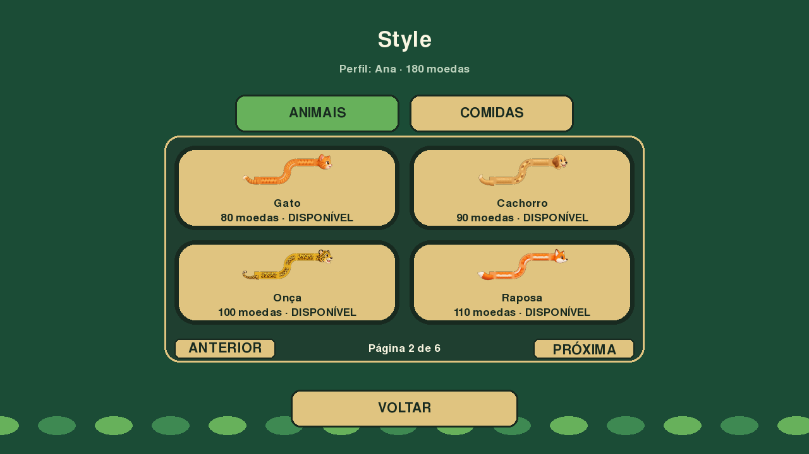
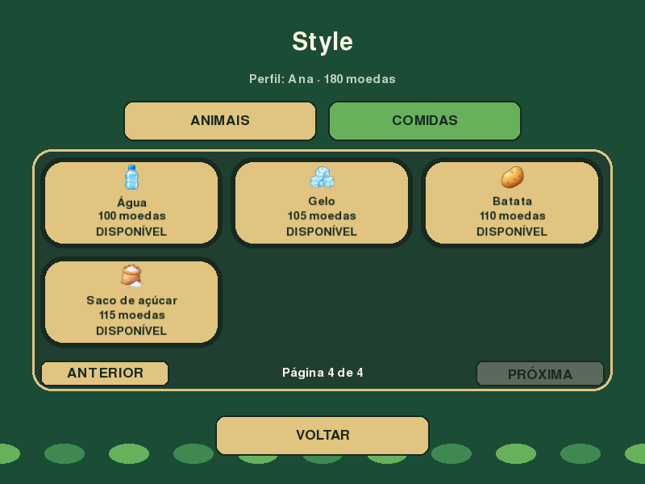
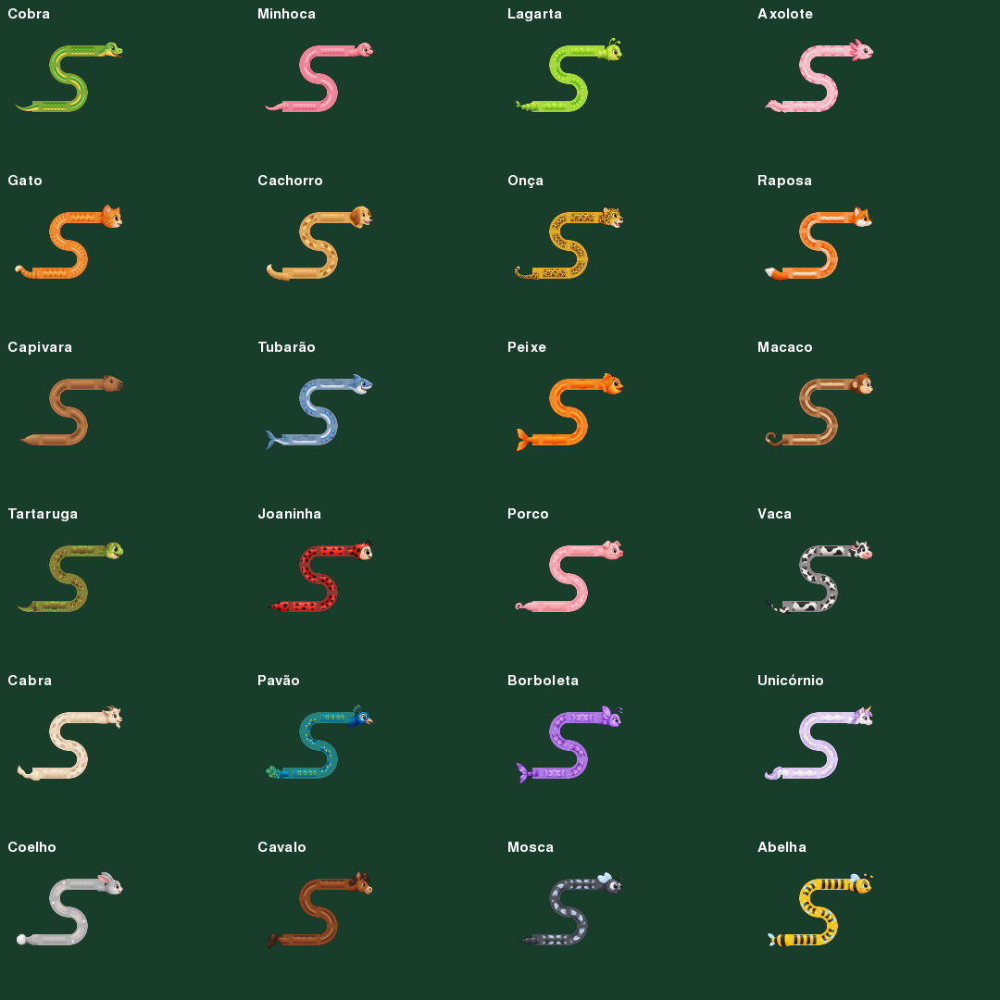

# Cosmetic Catalog

All styles are cosmetic. Food grants one point and one coin; every animal uses
identical movement, growth and collision rules. Purchases equip the item
automatically and are saved separately for each local profile.

## Animals

4 cards per page.

| Name | ID | Coins |
|---|---|---:|
| Cobra | `snake` | 0 |
| Minhoca | `worm` | 20 |
| Lagarta | `caterpillar` | 40 |
| Axolote | `axolotl` | 70 |
| Gato | `cat` | 80 |
| Cachorro | `dog` | 90 |
| Onça | `jaguar` | 100 |
| Raposa | `fox` | 110 |
| Capivara | `capybara` | 120 |
| Tubarão | `shark` | 130 |
| Peixe | `fish` | 140 |
| Macaco | `monkey` | 150 |
| Tartaruga | `turtle` | 160 |
| Joaninha | `ladybug` | 170 |
| Porco | `pig` | 180 |
| Vaca | `cow` | 190 |
| Cabra | `goat` | 200 |
| Pavão | `peacock` | 210 |
| Borboleta | `butterfly` | 220 |
| Unicórnio | `unicorn` | 230 |
| Coelho | `rabbit` | 240 |
| Cavalo | `horse` | 250 |
| Mosca | `fly` | 260 |
| Abelha | `bee` | 270 |

## Foods

6 cards per page.

| Name | ID | Coins |
|---|---|---:|
| Maçã | `apple` | 0 |
| Morango | `strawberry` | 5 |
| Queijo | `cheese` | 10 |
| Cupcake | `cupcake` | 15 |
| Pizza | `pizza` | 25 |
| Sushi | `sushi` | 35 |
| Laranja | `orange` | 40 |
| Maracujá | `passion_fruit` | 45 |
| Uva | `grapes` | 50 |
| Tomate | `tomato` | 55 |
| Pepino | `cucumber` | 60 |
| Palmito | `heart_of_palm` | 65 |
| Abóbora | `pumpkin` | 70 |
| Balinhas | `candies` | 75 |
| Bombons | `chocolates` | 80 |
| Pudim | `pudding` | 85 |
| Jujuba | `jelly_beans` | 90 |
| Suco | `juice` | 95 |
| Água | `water` | 100 |
| Gelo | `ice` | 105 |
| Batata | `potato` | 110 |
| Saco de açúcar | `sugar_bag` | 115 |

## Assets and provenance

The 96 animal parts and 16 new food icons in Feature 014 are original assets
generated with the built-in imagegen tool. The six existing food sprites are
preserved. No third-party art or additional runtime dependency was added.

Animal PNGs retain square transparent canvases. The renderer bounds original
surfaces to 256 pixels, enforces centered connectors and nominal 40% body
thickness, blends seams, and caches transforms. Style, gameplay and Game Over
share the renderer. Food originals are also bounded to 256 pixels.

Animal assets: `src/snake_game/assets/characters/<id>/head.png`,
`body_straight.png`, `body_curve.png`, `tail.png`.
Food assets: `src/snake_game/assets/foods/<id>.png`. All PNGs ship in the wheel.

Exact prompts and source filenames are recorded in
[ASSET_GENERATION.json](ASSET_GENERATION.json).

## Visual review

All catalog pages were reviewed at 800×600, 1280×720 and 1920×1080. Animal
connections were checked in straight, vertical, S, U and all four curved paths.

